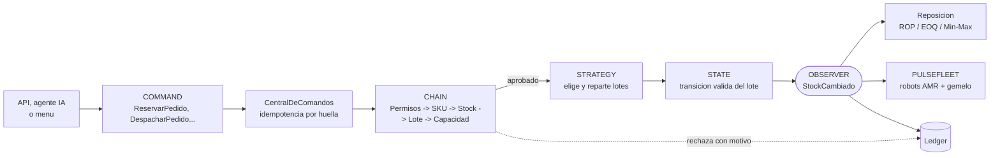
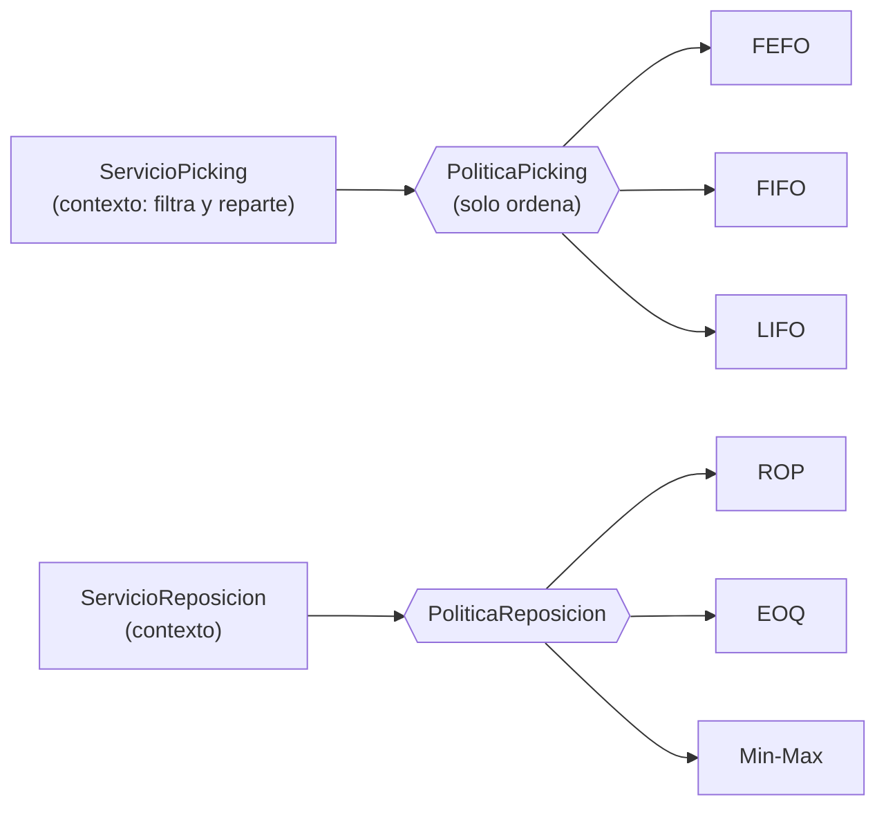
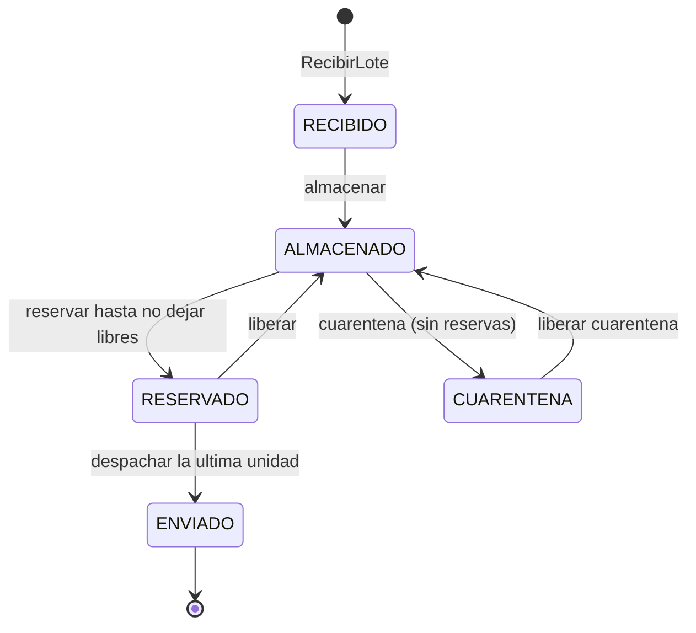
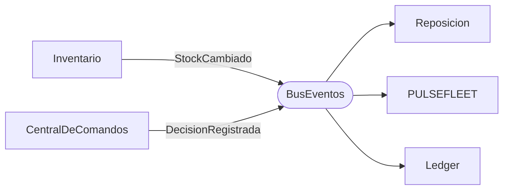

# LOGISTPULSE Smart Inventory · Patrones de comportamiento

Inventario inteligente de LOGISTPULSE en **Java 17, sin librerías externas**. Aplica cinco patrones de comportamiento sobre la lógica real de una bodega: recepción, almacenamiento, reservas repartidas entre lotes, despachos, ajustes, transferencias entre bodegas, cuarentena y reposición automática. Humanos y agentes de IA entran por el mismo punto, pasan por los mismos controles (permisos incluidos) y todo queda auditado.

| # | Patrón | Qué resuelve en LOGISTPULSE | Carpeta |
|---|---|---|---|
| 1 | **Command** | Cada operación es un objeto auditable, idempotente (por huella) y compensable | `command/` |
| 2 | **Chain of Responsibility** | Guardrails: Permisos → SKU → Stock → Lote → Capacidad | `chain/` |
| 3 | **Strategy** | Picking (FEFO, FIFO, LIFO) y reposición (ROP, EOQ, Min-Max) intercambiables | `strategy/` |
| 4 | **State** | Ciclo de vida del lote; una transición inválida lanza una excepción | `state/` |
| 5 | **Observer** | `StockCambiado` llega a Reposición, PULSEFLEET y Ledger sin acoplarlos | `observer/` |

## Flujo de una operación



## Estructura

```
src/ec/edu/usfq/logistpulse/
├── App.java                  Demo por consola: 31 pasos en 4 secciones
├── MenuInteractivo.java      Menu para operar el inventario a mano
├── SistemaLogistPulse.java   Raiz de composicion: crea y conecta todo
├── EscenarioDemo.java        Datos de ejemplo, usuarios y fecha fija (2026-11-12)
├── RelojManual.java          Reloj inyectable que solo avanza cuando se le pide
├── dominio/                  Actor, Rol, Bodega, ProductoSku, Cantidades...
├── inventario/               ConsultasInventario, OperacionesInventario, Inventario, Reserva
├── command/                  1. COMMAND
├── chain/                    2. CHAIN OF RESPONSIBILITY
├── strategy/picking/         3. STRATEGY (picking)
├── strategy/reposicion/      3. STRATEGY (reposicion)
├── state/                    4. STATE
├── observer/                 5. OBSERVER
└── consola/                  Reportes (solo presentacion)
test/ec/edu/usfq/logistpulse/
├── PruebasLogistPulse.java   Corre las 83 pruebas
├── command/ chain/ strategy/ state/ observer/   Una clase de pruebas por patron
├── PruebasRevision.java      Una prueba por cada hallazgo de la revision
└── MiniTest.java             Mini framework de pruebas (sin JUnit)
```

## Cómo ejecutarlo

Requisito: **JDK 17 o superior** (revisa con `java -version`). Ejecuta estos comandos desde la carpeta raíz del proyecto; funcionan igual en PowerShell, CMD, Terminal de Mac/Linux y GitHub Codespaces.

```bash
# 1. Compilar
javac -encoding UTF-8 -d out --source-path src src/ec/edu/usfq/logistpulse/App.java src/ec/edu/usfq/logistpulse/MenuInteractivo.java

# 2a. Ver la demo completa
java -cp out ec.edu.usfq.logistpulse.App

# 2b. O usar el menu interactivo
java -cp out ec.edu.usfq.logistpulse.MenuInteractivo

# 3. Compilar y correr las pruebas
javac -encoding UTF-8 -d out -cp out --source-path test test/ec/edu/usfq/logistpulse/PruebasLogistPulse.java
java -cp out ec.edu.usfq.logistpulse.PruebasLogistPulse
```

**En VS Code:** instala *Extension Pack for Java*, abre la carpeta y pulsa **Run** sobre el `main` de `App.java` o de `MenuInteractivo.java`.

En la demo, debajo de cada paso aparece qué hizo cada patrón:

```
 [18] Andrea reserva 100 de leche (PERECIBLE usa FEFO; el pedido se reparte entre 2 lotes)
      RESERVAR 100 x LEC-200 en UIO-NORTE para PED-2002  | andrea.vera (operador)
      => EJECUTADO CMD-019
         chain:      Permisos:ok -> SKU:ok -> Stock:ok -> Lote:ok -> Capacidad:ok
         strategy:   FEFO: L-LEC-1108 x70, L-LEC-1103 x30
         evento:     L-LEC-1108@UIO-NORTE  ALMACENADO -> RESERVADO  reservado +70
         evento:     L-LEC-1103@UIO-NORTE  ALMACENADO  reservado +30
         reposicion: OC-002 pedir 190 x LEC-200 a UIO-NORTE (MIN-MAX: posicion 60 <= min 80, se completa hasta max 250)
```

## Usuarios y permisos

| Rol | Puede | Reservas |
|---|---|---|
| OPERADOR (humano o agente de IA) | recibir, almacenar, reservar, despachar, transferir | Solo libera o despacha **las suyas** |
| SUPERVISOR | todo | Gestiona las de cualquiera |
| CALIDAD | cuarentena, salir de cuarentena, ajustes (merma, conteo) | — |

Cada comando declara qué roles lo pueden pedir. La regla de dueño vive en un solo lugar (`Reserva.puedeGestionar`) y la usan tanto la cadena como el inventario, así que tampoco se puede saltar llamando directo al receptor.

---

## 1. Command

| Rol | Clase |
|---|---|
| Command | `ComandoInventario`, `ComandoBase` |
| Concrete Command | `RecibirLote`, `AlmacenarLote`, `ReservarPedido`, `LiberarReserva`, `DespacharPedido`, `AjustarStock`, `TransferirStock`, `PonerEnCuarentena`, `LiberarCuarentena` |
| Invoker | `CentralDeComandos` (solo orquesta; no conoce comandos ni eslabones concretos) |
| Receiver | `OperacionesInventario` (interfaz), implementada por `Inventario` |
| Historial | `observer/Ledger` (recibe `DecisionRegistrada`) |

| Comando | Inverso (compensación) |
|---|---|
| `ReservarPedido` | `LiberarReserva` (libera exactamente los lotes que eligió la estrategia) |
| `LiberarReserva` | `ReservarPedido` |
| `AjustarStock(+n)` | `AjustarStock(-n)` |
| `TransferirStock(A → B)` | `TransferirStock(B → A)` |
| `PonerEnCuarentena` | `LiberarCuarentena` (y al revés) |
| `RecibirLote`, `AlmacenarLote`, `DespacharPedido` | **Irreversibles**: se corrigen con una operación nueva |

- **Idempotencia por huella:** cada comando calcula una huella con todos sus datos (tipo, actor, SKU, bodegas, lote, pedido, cantidad, razón...).
  - Misma clave y misma huella: es un reintento → `DUPLICADO`, no se aplica de nuevo.
  - Misma clave con otra huella: se **rechaza y se audita** ("la clave ya se usó para otra operación"). No hay falso OK.
  - Si un comando falla, su clave queda libre para reintentar.
- **Deshacer nunca pierde comandos:** `deshacerUltimo` hace `peek`, no `pop`. El comando sale del historial solo si la compensación se ejecutó; si falla, sigue en el tope y el intento queda en el ledger.
- **Compensar dos veces** lo mismo, aunque lo pida otra persona, es `DUPLICADO`.
- **En la demo:**
  - pasos 01–03: idempotencia y clave reutilizada;
  - pasos 12–16: un deshacer falla, no se pierde nada, y luego se deshace en orden LIFO;
  - paso 25: un despacho es irreversible;
  - pasos 30–31: compensación y compensación duplicada.

## 2. Chain of Responsibility

| Rol | Clase |
|---|---|
| Handler | `EslabonValidacion` (solo lee: recibe `ConsultasInventario`) |
| Concrete Handler | `FiltroAutorizacion` (Permisos), `FiltroSku`, `FiltroStock`, `FiltroLote`, `FiltroCapacidad` (+ `FiltroLimiteAgente`, opcional) |
| Request | `SolicitudMovimiento`, **declarativa** |
| Respuesta | `Veredicto` (eslabón, motivo y traza del recorrido) |

La solicitud dice **qué hay que revisar** (roles autorizados, unidades libres que consume, lote que usa, espacio que ocupa...). Cada eslabón revisa solo el requisito que le toca. **Ningún eslabón tiene un `switch` por tipo de operación**, así que agregar una operación no obliga a tocar la cadena.

| Eslabón | Revisa |
|---|---|
| Permisos | Que el rol esté autorizado y, en reservas, que sea el dueño o un supervisor |
| SKU | Que exista. Si está descontinuado, bloquea recibir y reservar |
| Stock | Que haya unidades libres suficientes del SKU |
| Lote | Que sirvan (no vencidas, fuera de cuarentena, almacenadas). También revisa reservas activas y códigos duplicados |
| Capacidad | Espacio físico o de alistamiento, con la **misma regla** que usa el inventario (`verificarEspacio`) |

- **En la demo:**
  - pasos 04–11 y 17: cada eslabón rechaza con su motivo, y se agrega `LimiteIA` sin tocar los comandos ni la central;
  - subsección "Defensa en profundidad".

## 3. Strategy



- **La política solo ordena** (`Comparator`). El contexto `ServicioPicking` aplica el **filtro de seguridad común**: descarta lotes vencidos, en cuarentena, recién recibidos o sin unidades libres. Después reparte el pedido entre lotes, por ejemplo 70 unidades con dos lotes de 50 → 50 + 20.
- **Contratos documentados (L de SOLID):**
  - si no alcanza, el plan lo indica con `cubreTodo() == false`;
  - una cantidad inválida lanza `IllegalArgumentException`, igual en las tres políticas;
  - las políticas de reposición nunca lanzan excepciones y validan sus parámetros al construirse.
- El inventario depende de la interfaz `AsignadorLotes`; nunca hace `new PickingFefo()`.

| Categoría | Picking | Reposición |
|---|---|---|
| PERECIBLE | FEFO | Min-Max (80 / 250) |
| ABARROTES | FIFO | EOQ (S = 20, H = 1.5) |
| MATERIALES | LIFO | ROP con cantidad fija de 100 |

- **En la demo:** pasos 18–20, con una comparación de qué lotes tomaría cada estrategia y un cambio de política **en ejecución**.

## 4. State



| Estado | Permite |
|---|---|
| RECIBIDO | almacenar, ajustar |
| ALMACENADO | reservar, liberar, despachar lo reservado, ajustar, transferir, recibir transferencias, cuarentena (si no tiene reservas) |
| RESERVADO | liberar, despachar, ajustar, recibir transferencias |
| CUARENTENA | salir de cuarentena, ajustar (dar de baja) |
| ENVIADO | nada (estado final) |

- `Lote` es el contexto y no tiene ningún `if` sobre su estado.
- Sus campos son privados, protege `0 <= reservado <= fisico` (un `CHECK` en SQL) con aritmética que no se desborda, y hacia afuera solo se entrega `VistaLote` (de solo lectura).
- **En la demo:** pasos 21–28.

## 5. Observer



| Rol | Clase |
|---|---|
| Publisher | `PublicadorEventos` (interfaz: solo `publicar`) y `BusEventos` (gestiona suscripciones por tipo) |
| Subscriber | `Suscriptor<E>` (interfaz funcional) |
| Concrete Subscriber | `ServicioReposicion`, `PulseFleet` (tabla de reglas, sin `switch`), `Ledger` (un suscriptor por tipo, sin `instanceof`) |
| Eventos | `StockCambiado`, `DecisionRegistrada`: `record`s inmutables con `Instant` |

- Los eventos se publican cuando la operación terminó completa.
- Si un suscriptor falla, los demás igual reciben el evento.
- **En la demo:**
  - todas las líneas `evento:`, `reposicion:` y `pulsefleet:`;
  - en los pasos 29–31, PULSEFLEET se da de baja y vuelve.

---

## SOLID

| Principio | Cómo se cumple | Dónde se comprueba |
|---|---|---|
| **S** | `Inventario` guarda y opera; `CentralDeComandos` orquesta; `ServicioPicking` elige lotes; `Reportes` solo imprime; `SistemaLogistPulse` solo conecta | Revisión de clases |
| **O** | Comando, eslabón, estrategia, estado o suscriptor nuevos no tocan lo existente. Sin `switch` por tipo de operación: la solicitud es declarativa y PULSEFLEET usa una tabla de reglas | `PruebasChain` (operación inventada) · `PruebasObserver` (regla nueva) |
| **L** | Contratos escritos en cada interfaz (qué devuelve y qué lanza) y probados en todas las implementaciones | `PruebasStrategy` · `PruebasState` |
| **I** | El inventario tiene dos interfaces separadas: `ConsultasInventario` (lectura) y `OperacionesInventario` (escritura). Además `PublicadorEventos` solo publica y `VistaLote` solo lee | `PruebasRevision` |
| **D** | Comandos → `OperacionesInventario`; eslabones y reposición → `ConsultasInventario`; inventario → `AsignadorLotes` y `PublicadorEventos`. Todo se compone en `SistemaLogistPulse` | `PruebasRevision` (por reflexión) |

## Hallazgos de la revisión y cómo se resolvieron

| Hallazgo | Solución | Prueba |
|---|---|---|
| Idempotencia que da "falso OK" con la misma clave y otros datos | Huella de la operación; la clave reutilizada se rechaza y se audita | `Idempotencia por huella...` |
| Si `undo` falla, se pierde el comando | `peek` en vez de `pop`; el comando sale solo si se compensó | `Si deshacer falla...` y `deshacerUltimo que falla...` |
| Solo Reserve pasa por la cadena | Las 9 operaciones pasan por la central y la cadena | `Todas las operaciones pasan por la cadena` |
| Transferir desde cuarentena permitido | El estado CUARENTENA lo prohíbe | `Transferir desde un lote en cuarentena...` |
| Ajuste de +500 supera la capacidad | La cadena **y** el receptor validan con la misma regla | `Ajuste +500 sobre la capacidad...` |
| El receptor depende solo de la cadena | Defensa en profundidad: valida capacidad, vencimiento, dueño, SKU y duplicados | `Defensa en profundidad...` |
| Sin control de propiedad al liberar | Rol + dueño de la reserva (supervisor como excepción) | `Propiedad: otro operador no libera...` |
| Una reserva solo sale de un lote | Reparto entre lotes en el contexto de picking | `Un pedido de 70 con dos lotes de 50...` |
| Faltan Adjust y Transfer | Recepción, merma, conteo y traslado existen | `Existen recepciones, mermas...` |
| Desbordamiento de enteros | Tope por operación (`Cantidades.MAXIMO`) y aritmética en `long` | `Desbordamiento de enteros...` |
| Ledger como texto | `record`s inmutables con `Instant` | `Ledger tipado...` |
| Campos públicos en el dominio | Campos privados; hacia afuera solo `VistaLote` | `Dominio encapsulado...` |
| `switch` por tipo de operación en los eslabones | Solicitud declarativa | `Ningun eslabon depende del tipo de operacion` |
| Políticas que lanzan excepciones no documentadas | Contratos escritos y probados | `Contrato: si no alcanza lo indica...` |
| Falta menú, tests, CI y documentación | Menú interactivo, 83 pruebas, GitHub Actions y este README | `INTEGRACION` |

## Decisiones de diseño

- **Reservas parciales:** un lote sigue ALMACENADO mientras le queden unidades libres y pasa a RESERVADO cuando ya no le queda ninguna.
- **Salida de cuarentena:** se sale de CUARENTENA de vuelta a ALMACENADO cuando calidad aprueba el lote. Para destruirlo se ajusta a 0.
- **Chain y State se complementan:** la cadena revisa reglas de negocio antes de ejecutar; el State garantiza que la transición sea legal. Los rechazos dicen quién los hizo: `[Permisos]`, `[SKU]`, `[Stock]`, `[Lote]`, `[Capacidad]`, `[State]` o `[Command]`.
- **Posición de inventario:** para reponer cuenta el stock utilizable más lo ya pedido; al recibir mercadería se cierra la orden pendiente.
- **Transferencia atómica:** se valida el destino antes de tocar el origen, y el lote trasladado conserva su fecha de ingreso.
- **Reloj inyectado:** la demo y las pruebas usan `RelojManual`, que arranca el 2026-11-12 a las 08:00.

## Límites (es un prototipo)

- Todo vive **en memoria**: no hay base de datos ni persistencia.
- **No es seguro para concurrencia:** está pensado para un solo hilo y no hay transacciones entre procesos.
- La identidad del actor se confía al cliente: no hay autenticación real (login, tokens).
- PULSEFLEET y el gemelo digital son simulaciones que registran tareas y zonas; no controlan robots reales.

## Cómo extender

- **Nueva operación:** extiende `ComandoBase`, arma su `SolicitudMovimiento` con los requisitos que necesita e implementa `ejecutar()` e `inverso()`. No hay que tocar la cadena.
- **Nuevo control:** extiende `EslabonValidacion` y agrégalo en `CadenaValidacion.armar(...)`.
- **Nueva política:** implementa `PoliticaPicking` (un `Comparator`) o `PoliticaReposicion` y asígnala con `usarParaCategoria(...)` o `usarParaSku(...)`.
- **Nuevo estado:** implementa `EstadoLote` y sobrescribe solo las operaciones que permite.
- **Nuevo suscriptor o movimiento físico:** implementa `Suscriptor<...>` y suscríbelo, o agrega una `PulseFleet.Regla`.

## Referencias

- Refactoring.Guru, patrones de comportamiento.
- Netflix Hystrix (`HystrixCommand`) · Spring Security (`SecurityFilterChain`, `DelegatingPasswordEncoder`) · AWS Step Functions · Spring `ApplicationEventPublisher`.

---
Universidad San Francisco de Quito · Colegio de Ciencias e Ingenierías
